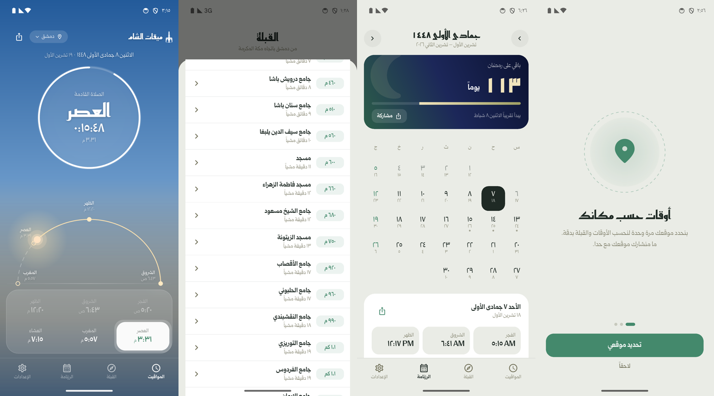

# ميقات الشام

تطبيق أندرويد لمواقيت الصلاة حسب موقعك، بتصميم مستوحى من سماء الشام وهوية جامع الصحابي أنيس الأنصاري.

## التحميل

<table>
<tr>
<td>

**[⬇️ تحميل أحدث نسخة (APK)](https://github.com/AbdullahAlHallak/miqat-alsham/releases/latest/download/MiqatAlSham.apk)**

1. افتح الرابط من الجوال، أو امسح الرمز.
2. افتح الملف بعد التحميل واضغط «تثبيت».
3. أول مرة بيطلب الجوال السماح بتثبيت تطبيقات من خارج المتجر.

</td>
<td></td>
</tr>
</table>

بعدها التطبيق بينبّهك لحاله لما تنزل نسخة جديدة، وبتبقى إعداداتك ومدينتك كما هي.

## المزايا

- **مواقيت دقيقة حسب موقعك** بطريقة رابطة العالم الإسلامي، مع مذهب العصر ومعايرة كل صلاة
- **أذان وتذكير قبله** بنغمات مختارة، وخطوات تضمن وصول التنبيه على شاومي وهواوي وغيرها
- **القبلة** ببوصلة، و**أقرب المساجد** مع الطريق إليها على خرائط Google
- **رزنامة هجرية** مع المناسبات، وعدّاد رمضان، وتذكير الجمعة
- **ويدجت** للشاشة الرئيسية
- أرقام هندية أو عربية، وصيغة ص/م أو AM/PM، ووضع فاتح وداكن

## الإبلاغ عن مشكلة أو اقتراح

من تبويب **[Issues](../../issues/new/choose)** اختر «مشكلة بالتطبيق» أو «فكرة أو اقتراح».

## ملاحظات

- هذا المستودع **للإصدارات فقط**. الكود المصدري خاص وغير منشور.
- كل إصدار مرفق معه ملف `SHA256SUMS.txt` للتحقق من سلامة الملف.
- [سجل التغييرات](CHANGELOG.md) · [سياسة الخصوصية](PRIVACY.md) · [الترخيص](LICENSE.md)

